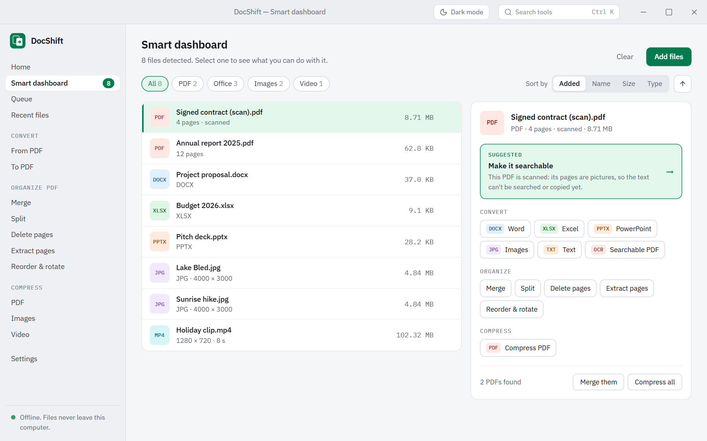
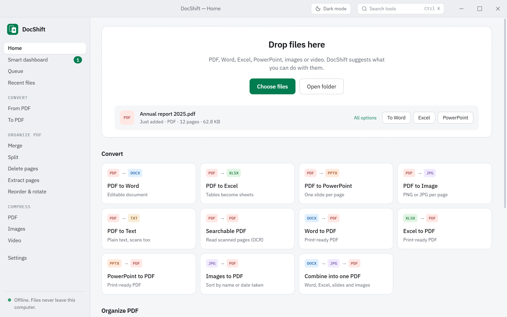
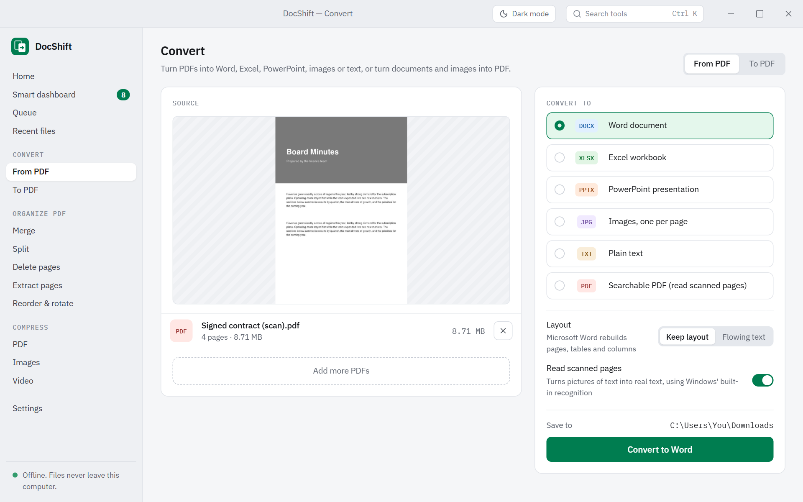
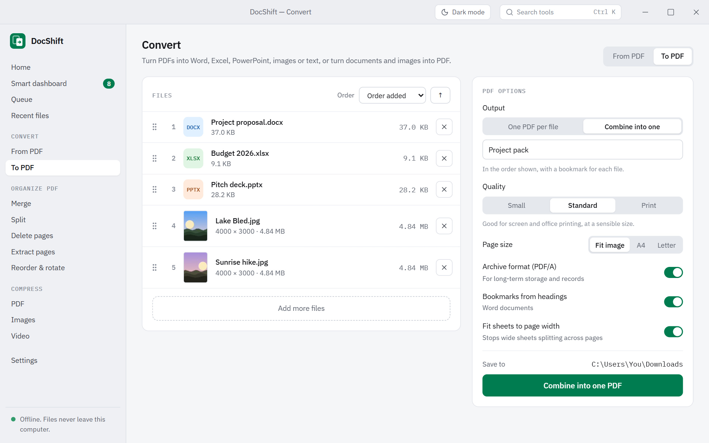
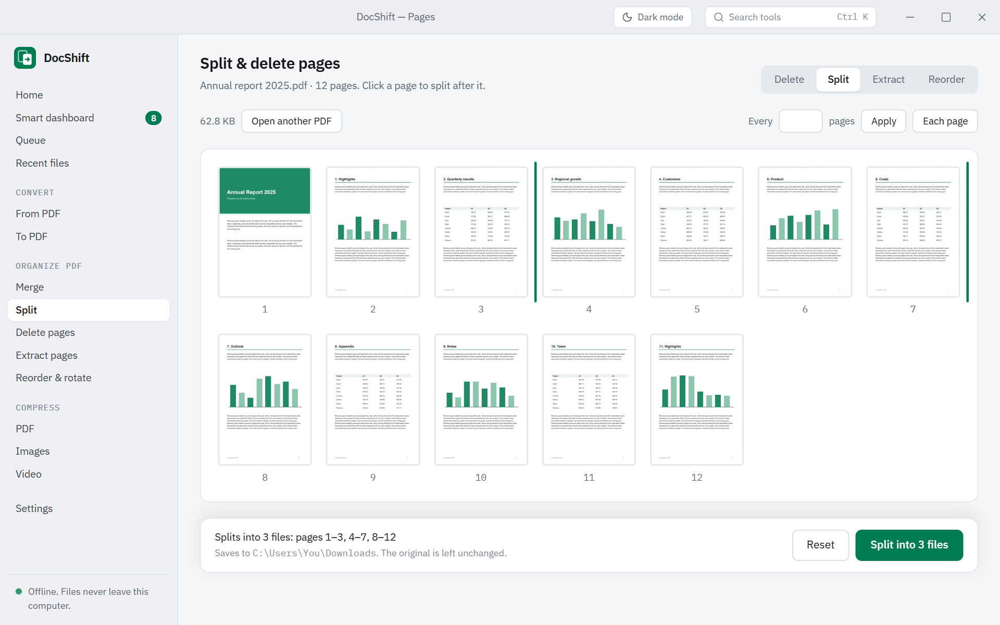
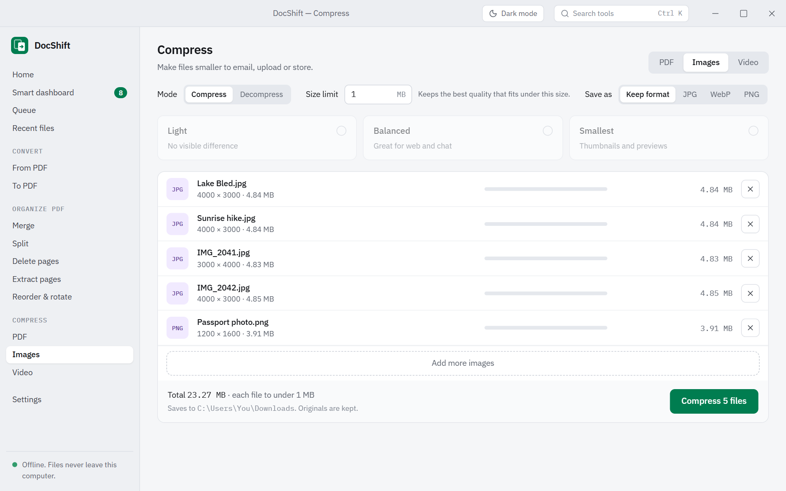
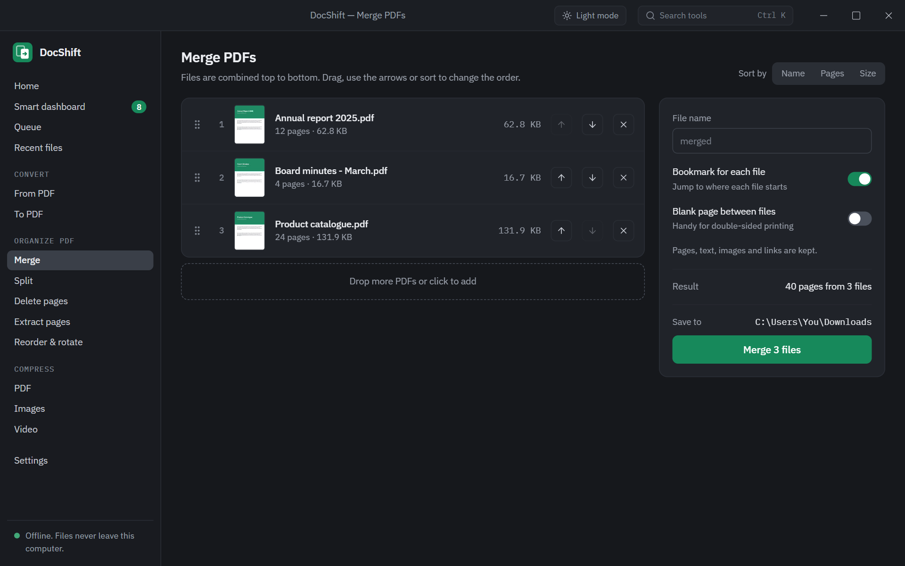

<div align="center">


# DocShift

**One offline desktop app to convert, compress and edit PDFs, Office documents, images and video.**
Drop any file: DocShift recognises it and offers exactly the tools that make sense.

[](https://github.com/aalokpathak/DocShift/releases/latest/download/DocShift-Setup.exe)
[](https://github.com/aalokpathak/DocShift/releases/latest/download/DocShift-Portable.exe)




</div>

## Download

Get the latest version from the **[Releases page](https://github.com/aalokpathak/DocShift/releases/latest)**:

| File | What it is |
|---|---|
| **[DocShift-Setup.exe](https://github.com/aalokpathak/DocShift/releases/latest/download/DocShift-Setup.exe)** | Installer. Per-user, no admin rights needed. Adds a Start menu shortcut and an uninstaller. |
| **[DocShift-Portable.exe](https://github.com/aalokpathak/DocShift/releases/latest/download/DocShift-Portable.exe)** | Single file. Put it anywhere (USB stick, Downloads) and double-click. Nothing is installed. |
| [SHA256SUMS.txt](https://github.com/aalokpathak/DocShift/releases/latest/download/SHA256SUMS.txt) | Checksums to verify your download. |

> Windows SmartScreen may warn the first time, because the files aren't code-signed: click **More info → Run anyway**.
> On first launch DocShift unpacks its built-in video and PDF engines (about 100 MB) to `%LOCALAPPDATA%\DocShift`.

## What's new in 2.0

DocShift 2.0 is a complete rewrite of the original Python app in **Tauri 2 + Rust + React 19 + TypeScript + Tailwind 4**:
much faster, a single small window, and a new design.

- **Smart dashboard**: drop a mix of files and get the right tools for each one, with a suggested next step
- **Read scanned pages (OCR)** with the text recognition built into Windows: make scanned PDFs searchable, or turn them into
  editable Word, Excel, PowerPoint or plain text
- **PDF tools**: merge (with a bookmark per file), split, extract, delete, reorder and rotate pages with live thumbnails
- **Combine Word, Excel, PowerPoint and photos into one PDF**, with *Small / Standard / Print* quality and **PDF/A** for archiving
- **Sort photos** by file name, date taken, date modified or the order you added them before making a PDF
- **PDF → plain text** and **PDF → Word as flowing text**
- **HEIC (iPhone) and AVIF photos** supported everywhere
- **Video resolution** choice (1080p / 720p / 480p), also combined with a size limit
- **Keep both / Replace / Ask** when a file with the same name exists
- Custom title bar, light and dark themes, **Ctrl K** tool search

## The smart dashboard

Drop **anything**: a PDF, a folder of photos, a Word file, a video, or a mix. DocShift detects each file and shows only the
tools that fit, with a suggestion and the reason for it:

| You drop | DocShift suggests | and offers |
|---|---|---|
| a scanned PDF | **Make it searchable** | to Word / Excel / PowerPoint / text with OCR, all PDF tools |
| a large PDF | **Compress PDF** (most mail services stop at 20–25 MB) | convert, merge, split, pages |
| two or more PDFs | **Merge** | everything above, for each file |
| Word, Excel or PowerPoint files | **Convert to PDF** | combine them all into one PDF |
| several photos | **Combine into a PDF**, sorted your way | compress, convert to JPG / WebP |
| a video | **Compress** | 1080p / 720p / 480p, a size limit, lossless copy |

Prefer menus? Every tool is also in the sidebar, and **Ctrl K** searches all of them.

<div align="center">

</div>

## Features

### Convert from PDF
- **PDF → Word**: *Keep layout* uses Microsoft Word's own PDF import (pages, tables and columns rebuilt);
  *Flowing text* writes clean paragraphs and headings that reflow when you edit (works without Word too)
- **PDF → Excel**: tables become real cells and numbers stay numbers; one sheet per page or all on one sheet
- **PDF → PowerPoint**: editable text boxes over the page background, or exact page pictures
- **PDF → images**: PNG, JPG, WebP or TIFF at 72–300 dpi, all pages or a range
- **PDF → plain text**: keep the layout (columns line up) or flowing paragraphs
- **Read scanned pages**: scanned pages are recognised with Windows' built-in OCR first, so all of the above work on scans.
  Or create a **searchable PDF**: it looks exactly the same, but the text can now be searched, selected and copied.
  Pick the recognition language in Settings.

<div align="center">

</div>

### Convert to PDF
- **Word / Excel / PowerPoint → PDF**, exported by Microsoft Office itself, so fonts, tables, headers and charts match the
  original (LibreOffice is used if Office isn't installed). Word headings can become PDF bookmarks; wide Excel sheets fit the page width.
- **Images → PDF** (JPG, PNG, HEIC, AVIF, WebP, TIFF including multi-page scans, BMP, GIF) with *fit to image*, A4 or Letter pages.
  JPEGs are embedded untouched, so there is no quality loss.
- **Combine into one PDF**: any mix of Word, Excel, PowerPoint and images, in the order you choose, with a bookmark for each file
- **Quality**: *Small* (smallest file, text stays sharp), *Standard* (sensible size for screen and office printing) or *Print* (full resolution)
- **PDF/A** (archive format) for long-term storage and records

<div align="center">

</div>

### Sort images into the order you want
Arrange photos by **file name** (natural order, so `IMG_2` comes before `IMG_10`), **date taken** (from the photo's EXIF data),
**date modified**, **date created**, **file size** or the **order you added them**. Flip the direction, or drag them into any
custom order. Merging PDFs can be sorted by name, pages or size the same way.

### PDF tools
- **Merge** any number of PDFs, with a **bookmark for each file** and an optional **blank page between files** (for double-sided printing)
- **Split** after the pages you click, every N pages, or one file per page, with a live summary of the files you'll get
- **Extract** the pages you click (or type ranges like `1-3, 7`)
- **Delete** unwanted pages
- **Reorder & rotate**: drag pages into a new order, turn them, remove them, all with real page thumbnails

<div align="center">

</div>

### Compress & decompress, to an exact size
Type a size in **MB** (for example `2`) for sites with upload limits. DocShift finds the **best quality that still fits** and only
lowers the resolution when quality alone can't get there. Or pick *Light*, *Balanced* or *Smallest*.

| | Compress | Decompress |
|---|---|---|
| **PDF** | Re-encodes embedded images; flattens pages only as a last resort | Stores every stream uncompressed |
| **Image** | JPG / WebP quality search, PNG colour reduction, optional format change (HEIC → JPG) | Lossless PNG, or uncompressed TIFF / BMP |
| **Video** | H.264 MP4 at a quality level, a resolution (1080p / 720p / 480p), or a two-pass encode at the exact bitrate for your size | Lossless (FFV1 in MKV) |

1 MB = 1,000,000 bytes, the stricter convention, so a result that fits is accepted by sites using either definition.
If a limit is impossible you are told the smallest size reached instead of getting a file the site would reject.

<div align="center">

</div>

### Built for everyday use
- Drag and drop anywhere in the window, choose files, or open a whole folder
- Saves to your Downloads folder by default; change it any time
- If a file with the same name exists: **keep both**, **replace**, or **ask** each time
- Per-file progress, a real progress bar for video, and a **Cancel** that stops immediately
- **Recent files** list (kept on your computer for 30 days, can be turned off) with Open and Show in folder
- Light, dark and system themes; works fully offline, no account, files never leave your computer
- Password-protected and damaged files are reported clearly; one bad file never stops a batch
- Macros in Office files are never run, and any Office process DocShift starts is closed again

<div align="center">

</div>

## Built with

| | |
|---|---|
| **Shell** | [Tauri 2](https://tauri.app/): a small native window using the system WebView2, with a custom title bar |
| **Engine** | **Rust**: [lopdf](https://crates.io/crates/lopdf) (PDF editing, PDF/A), [PDFium](https://pdfium.googlesource.com/pdfium/) via pdfium-render (rendering, text positions), `image` + `jpeg-encoder` + `webp` + `tiff` (images), Windows.Media.Ocr (text recognition), a hand-written COM layer for Microsoft Office, [FFmpeg](https://ffmpeg.org/) (video, HEIC/AVIF) |
| **UI** | **React 19** + **TypeScript** + **Tailwind CSS 4**, state in Zustand, IBM Plex fonts bundled for offline use |

Design notes:
- All heavy work runs in Rust off the UI thread, with progress, cancellation and "file exists" questions streamed to the UI as events. Image batches run in parallel.
- OCR adds an invisible text layer exactly over each recognised word, so scanned pages then flow through every other tool like a normal PDF.
- The native engines (FFmpeg, PDFium) are compressed into the executable and unpacked on first use, which is why the portable build is a single file.

## Requirements

- Windows 10 or 11 with the (built-in) Microsoft Edge WebView2 runtime
- **Microsoft Office** for the best Office conversions. Without it, LibreOffice is used if installed; PDF → Word falls back to flowing text.
- Text recognition uses the languages installed in Windows (Settings → Time & language → Language & region).

## Limitations

- PDF → Word / Excel / PowerPoint is approximate by nature: a PDF stores positioned text, not paragraphs or cells. Office → PDF is exact.
- OCR quality depends on the scan; check names and numbers. Handwriting isn't recognised.
- PDF/A output is written to the PDF/A-2b rules (Word and PowerPoint use Office's own PDF/A export) but isn't certified by a validator.
- Compressing a PDF that is mostly text can't shrink it much; a very tight limit may flatten pages to images (you are told).
- Password-protected files must be unlocked first. Animated GIFs aren't supported by *Compress images*.
- Windows only (Office automation and OCR use Windows APIs).

## Build from source

Requires [Node 20+](https://nodejs.org/), [Rust](https://rustup.rs/) (MSVC toolchain) and the Visual Studio C++ Build Tools.

```powershell
git clone https://github.com/aalokpathak/DocShift.git
cd DocShift
powershell -ExecutionPolicy Bypass -File scripts\fetch-engines.ps1   # downloads ffmpeg + pdfium (once)
npm install
npm run tauri dev        # run with hot reload
npm run tauri build      # release build
```

To produce exactly the downloads published on the Releases page (installer + portable + checksums) in `release\`:

```powershell
powershell -ExecutionPolicy Bypass -File scripts\build-release.ps1
```

`docshift.exe --selftest <folder>` runs one task per engine (Office, PDF, OCR, image and video) and writes `selftest.log`.
`docshift.exe --run <mode> <outDir> <optionsJson> <inputs...>` runs any single tool from the command line.

### Project layout

```
src/                 React + TypeScript UI (pages/, components/, lib/)
src-tauri/src/       Rust engine
  office.rs            Word / Excel / PowerPoint over COM, quality and PDF/A, process cleanup
  pdfops.rs            merge + bookmarks, pick/reorder/rotate pages, split, compress, images -> PDF  (lopdf)
  pdf2x.rs             PDF -> images / Excel / PowerPoint
  textout.rs           PDF -> plain text, PDF -> Word as flowing text
  ocr.rs               Windows OCR, invisible text layer, searchable PDFs
  pdfa.rs              PDF/A-2b: XMP metadata, sRGB output intent
  render.rs            PDFium wrapper: previews, text positions
  imgops.rs            image compress / decompress, HEIC/AVIF, EXIF dates
  video.rs             FFmpeg: size-targeted two-pass encode, resolution, progress, cancel
  jobs.rs, commands.rs job runner, events, "file exists" questions and the commands the UI calls
scripts/             fetch-engines.ps1, build-release.ps1
docs/screenshots/    the screenshots in this README
```

## License and credits

See [THIRD-PARTY-NOTICES.md](THIRD-PARTY-NOTICES.md). The release executables bundle a GPL build of FFmpeg.
