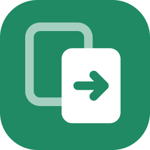
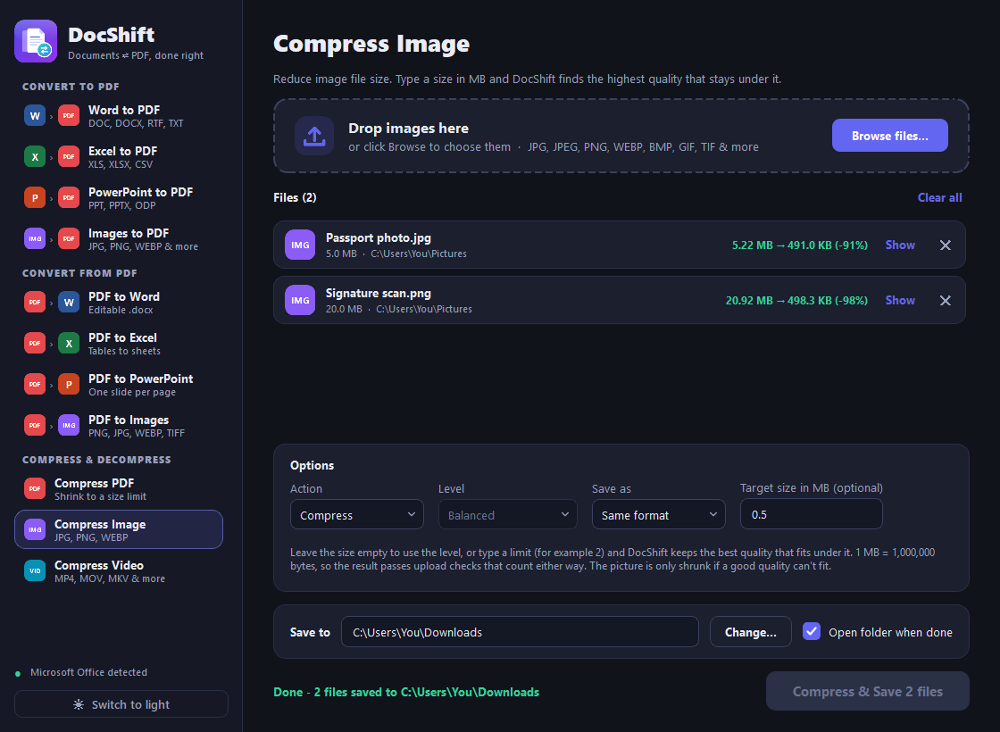
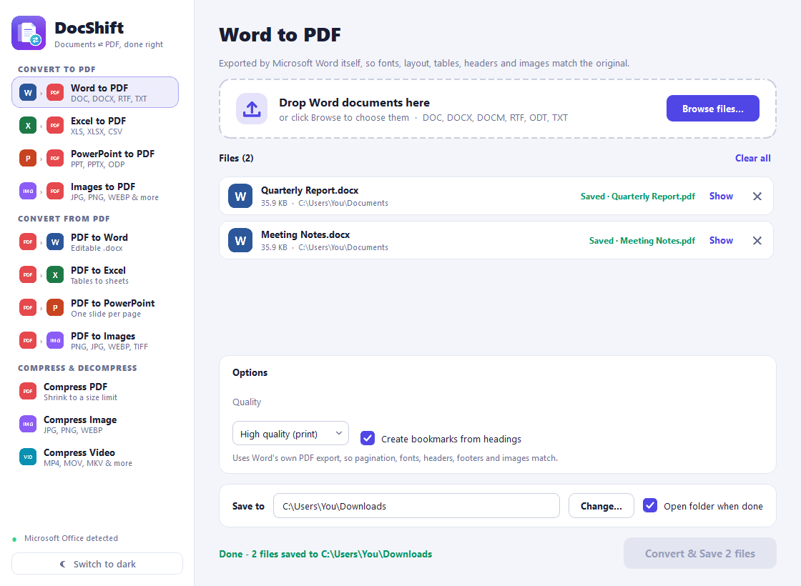
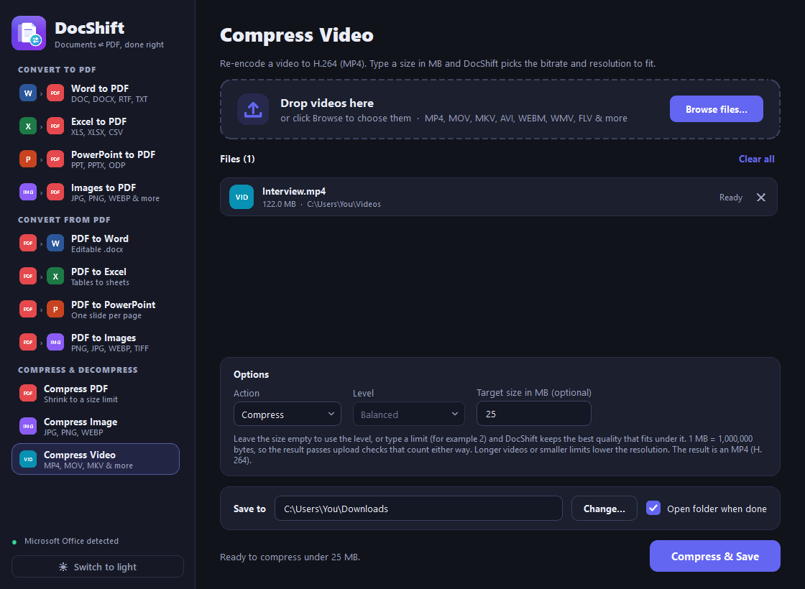

<div align="center">



# DocShift

**Convert Word, Excel, PowerPoint and images to PDF and back, and compress PDFs, images and videos to an exact size limit.**

[](https://github.com/aalokpathak/DocShift/releases/latest/download/DocShift.exe)




</div>

## Download

Grab **[DocShift.exe](https://github.com/aalokpathak/DocShift/releases/latest/download/DocShift.exe)** from the
[Releases page](https://github.com/aalokpathak/DocShift/releases/latest). It is a single portable file: no installer,
no Python needed. Just double-click it.

> Windows may show a SmartScreen prompt the first time because the exe isn't code-signed. Choose
> **More info → Run anyway**.

## What it does

### Convert

| To PDF | From PDF |
|---|---|
| Word → PDF (`.doc` `.docx` `.rtf` `.odt` `.txt`) | PDF → Word (editable `.docx`) |
| Excel → PDF (`.xls` `.xlsx` `.csv`) | PDF → Excel (tables become real cells) |
| PowerPoint → PDF (`.ppt` `.pptx` `.odp`) | PDF → PowerPoint (editable text, or exact page images) |
| Images → PDF (JPG, PNG, WEBP, BMP, GIF, TIFF) | PDF → Images (PNG, JPG, WEBP, TIFF, BMP, 72–600 dpi) |

### Compress & decompress

| | Compress | Decompress |
|---|---|---|
| **PDF** | Re-compresses embedded images, subsets fonts, cleans up the file | Rewrites every stream uncompressed (easy to inspect or edit) |
| **Image** (JPG, PNG, WEBP, BMP, TIFF) | JPG / WEBP quality search, PNG colour reduction, optional format change | Saves as lossless PNG, or uncompressed TIFF / BMP |
| **Video** (MP4, MOV, MKV, AVI, WEBM …) | H.264 MP4 with a quality level or an exact size limit | Saves losslessly (FFV1 in MKV) |

**Need to fit an upload limit?** Type the size in MB (for example `2`) in the optional **Target size** box. DocShift
then finds the best quality that still fits under it, and only lowers the resolution when quality alone can't get there.
Leave the box empty to use the Light / Balanced / Strong level instead. Sizes use 1 MB = 1,000,000 bytes, which is the
stricter convention, so a result that fits is accepted by sites that count either way.

Decompress rewrites a file in an uncompressed or lossless form. It **cannot bring back detail** that earlier lossy
compression removed, and the result is larger.

## Features

- **Faithful layout.** Word, Excel and PowerPoint are exported by Microsoft Office itself, the same engine as
  *Save as PDF*, so fonts, headers, footers, tables, charts and images match the original.
- **Hit an exact size.** Compress a PDF, image or video to under any size in MB, with the before and after size shown
  on every file.
- **Browse or drag & drop**, one file or many. The app switches to the right tool for the file type you drop.
- **Choose where to save.** Defaults to your Downloads folder; change it to any folder. Existing files are never
  overwritten (` (1)`, ` (2)`, …).
- **Smart options per tool.** Fit wide Excel sheets to one page, merge and reorder images into a single PDF, pick image
  format / DPI / page range, and more.
- **Per-file status**, real progress bar for video, and a Cancel button that stops an encode immediately. One bad file
  never stops the batch.
- **Light and dark themes**, keyboard accessible.
- **Safe by default.** Macros in opened Office files are always disabled; password-protected files are detected
  instantly and reported instead of hanging; Office instances DocShift starts are always closed again.

<div align="center">

<br><br>

</div>

## How it works

| Tool | Engine |
|---|---|
| Word / Excel / PowerPoint → PDF | Microsoft Office via COM automation. Falls back to LibreOffice if Office isn't installed. |
| Images → PDF | Pillow + PyMuPDF. JPG/PNG are embedded untouched (no re-compression). |
| PDF → Word | Word's PDF reflow engine. |
| PDF → Excel | PyMuPDF table detection plus a custom detector for tables without ruling lines; numbers stay numbers. |
| PDF → PowerPoint | PyMuPDF + python-pptx. *Editable* mode rebuilds text as real text boxes over a clean background image. |
| PDF → Images | PyMuPDF rendering. |
| Compress PDF | PyMuPDF image resampling and re-encoding, searching resolution and JPEG quality for the best fit. If images alone can't reach the limit, pages are flattened to pictures (text becomes non-selectable, and you are told). |
| Compress image | Pillow. Interpolating quality search; shrinks the picture only when a good minimum quality doesn't fit. |
| Compress video | Bundled ffmpeg (H.264 + AAC). With a size limit it computes the bitrate from the video length, picks a sensible resolution, runs a two-pass encode and tightens it if the result overshoots. |

## Requirements

- Windows 10 / 11
- **Microsoft Office** (Word, Excel, PowerPoint) for the best results. Word is required for *PDF → Word*.
  Image conversions, PDF → Excel / PowerPoint / Images, and all compression and decompression work without Office.

## Limitations

- **Scanned PDFs have no text layer and there is no OCR**, so they convert to page images only.
- PDF → Word / Excel / PowerPoint is inherently approximate, because a PDF stores positioned glyphs, not paragraphs
  or cells. Office → PDF is exact.
- A size limit can be impossible: a long video or a text-heavy PDF may not fit in a tiny limit. DocShift tells you the
  smallest size it reached (or the minimum needed) instead of saving a file that would be rejected.
- Animated GIFs and multi-page images aren't supported by *Compress Image*.
- Password-protected files must be unlocked first.
- Windows only (Office automation uses COM).

## Run from source / build the exe

```bash
git clone https://github.com/aalokpathak/DocShift.git
cd DocShift
python -m venv .venv
.venv\Scripts\pip install -r requirements.txt

.venv\Scripts\python app.py          # run
.venv\Scripts\python build.py        # build dist\DocShift.exe (also generates icon.ico from assets/icon.svg)
```

`DocShift.exe --selftest <folder>` runs one task per engine (including compression and a generated test video) and
writes `selftest.log`, which is handy for checking a build.

## Project layout

```
app.py          GUI (PyQt5): window, drag & drop, options, worker thread
converters.py   Office / image / PDF conversion logic, no GUI code
compressors.py  PDF, image and video compression and decompression, no GUI code
assets/         icon.svg (source of the app icon)
build.py        icon generation + PyInstaller build (bundles ffmpeg)
docs/           screenshots
```

## Built with

Python · PyQt5 · PyMuPDF · Pillow · python-pptx · openpyxl · pywin32 · imageio-ffmpeg (FFmpeg) · PyInstaller

## Licensing note

The exe bundles an FFmpeg build (GPL) and uses PyQt5 (GPL), so redistributing it is subject to the GPL. Add a LICENSE
that is compatible before sharing the code publicly.
